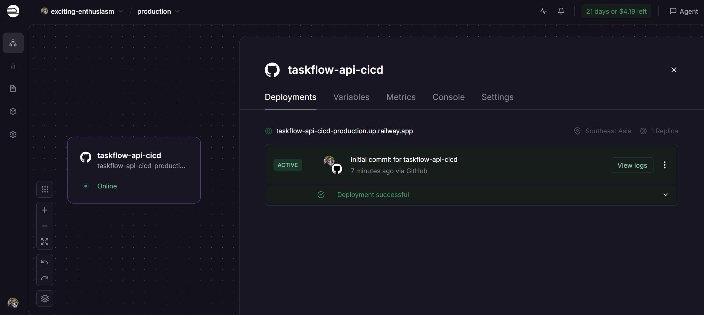
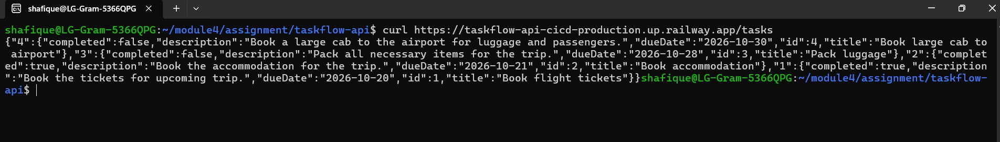
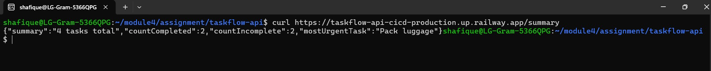
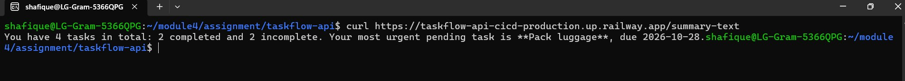

# TaskFlow API CICD
This API is prepare by **Mohammed Shafique Ur Razzaque**.

It's a Spring Boot REST API for managing a personal task list.
It has six TaskContoller endpoints using Spring Boot and two AI-powered AIContoller endpoints using Spring AI.

Built with Java 21, Spring Boot 4.1.1, Spring AI 2.0.1, Lombok and Maven.

The application is containerised with a multi-stage **Dockerfile** and deployed to **Railway**.

**Live URL:** https://taskflow-api-cicd-production.up.railway.app/tasks

Shows all tasks as a JSON object keyed by task id.

**Live URL:** https://taskflow-api-cicd-production.up.railway.app/summary

Uses Spring AI with the OpenAI API (served through OpenRouter's OpenAI-compatible endpoint)
to summarise the tasks. It returns typed JSON with a short `summary`, the
`countCompleted` and `countIncomplete` totals, and the `mostUrgentTask`.

**Live URL:** https://taskflow-api-cicd-production.up.railway.app/summary-text

Uses the same AI prompt to summarise the tasks, but returns the summary as plain-text
prose instead of JSON. The exact wording varies per call.

---

## Deployment to Railway

The app is deployed to [Railway](https://railway.app), which builds the image from
the `Dockerfile` in this repository and runs the container.

**Live URLs:**

- https://taskflow-api-cicd-production.up.railway.app/tasks — all tasks
- https://taskflow-api-cicd-production.up.railway.app/summary — AI summary of the tasks (JSON)
- https://taskflow-api-cicd-production.up.railway.app/summary-text — AI summary of the tasks (plain text)

Try them:

```bash
curl https://taskflow-api-cicd-production.up.railway.app/tasks
curl https://taskflow-api-cicd-production.up.railway.app/summary
curl https://taskflow-api-cicd-production.up.railway.app/summary-text
```

The `OPENAI_API_KEY` is set as a Railway service variable rather than committed to
the repository, so the AI endpoints (`/summary`, `/summary-text`) work in production
the same way they do locally.

### Screenshots

**Railway active deployment.** The `taskflow-api-cicd` service is *Online* in the
Southeast Asia region, and its latest deployment from GitHub is marked **ACTIVE** with
*Deployment successful*.



**Live `/tasks` endpoint.** `curl` against the Railway URL returns all four seeded
tasks as JSON keyed by id.



**Live `/summary` endpoint.** The AI summary, generated through OpenRouter, comes back
as typed JSON: 2 completed, 2 incomplete, with *Pack luggage* as the most urgent task.



**Live `/summary-text` endpoint.** The same AI summary returned as plain-text prose,
naming *Pack luggage* (due 2026-10-28) as the most urgent pending task.



---

## Docker

The project ships with a two-stage `Dockerfile`:

```dockerfile
# Stage 1: Build the JAR with Maven
FROM maven:3.9-eclipse-temurin-21 AS build
WORKDIR /app
COPY . .
RUN mvn clean package -DskipTests

# Stage 2: Run the JAR in a slim runtime image
FROM eclipse-temurin:21-jre-alpine
WORKDIR /app
COPY --from=build /app/target/*.jar app.jar
EXPOSE 8080
CMD ["java", "-jar", "app.jar"]
```

- **Stage 1 (build)** uses the full Maven + JDK 21 image to compile the code and
  package the executable jar.
- **Stage 2 (run)** copies only that jar into a small Alpine-based JRE 21 image.
  Maven, the JDK and the source code are left behind, so the final image is much
  smaller and has less in it to attack.

Build and run it locally:

```bash
docker build -t taskflow-api .
docker run -p 8080:8080 -e OPENAI_API_KEY=your-openrouter-key-here taskflow-api
```

The app is then available at **http://localhost:8080/tasks**.

---

## Key features

- Full CRUD over tasks — create, read, update, delete.
- A dedicated endpoint to mark a task complete, so clients need not resend the whole object.
- Server-generated ids, unique under concurrent requests.
- Consistent 404 handling for any unknown task id.
- Two AI summary endpoints: one returning typed JSON, one returning prose.
- Sample data seeded at startup, with dates relative to today so it never goes stale.

---

## Good design practices

### 1. Layered architecture

`controller → service → repository`. The service holds the business rules and imports
nothing web-related, so it stays reusable and can be unit-tested without a server.
The controller only chooses the HTTP status; the repository only stores.

### 2. Constructor injection on final fields

```java
private final TaskService taskService;

public TaskController(TaskService taskService) {
    this.taskService = taskService;
}
```

Every dependency is explicit and immutable. The class cannot exist in a half-built
state, and a test can construct it directly with a stub — no Spring context needed.

### 3. The repository does not leak its internal map

```java
public Map<Long, Task> getTasks() {
    return Map.copyOf(tasks);   // immutable snapshot
}
```

Callers receive a snapshot they cannot mutate, so nobody can add or delete behind the
service's back. All writes must go through `addTask` / `updateTask` / `removeTask`.

### 4. Thread-safe storage and server-generated ids

```java
private final Map<Long, Task> tasks = new ConcurrentHashMap<>();
private final AtomicLong idCounter = new AtomicLong();
```

`ConcurrentHashMap` makes the store safe under concurrent requests, and `AtomicLong`
guarantees unique ids without locking. Ids are assigned by the server, so a client
cannot choose its own and collide with an existing task.

### 5. A domain exception, not an HTTP exception

```java
public class TaskNotFoundException extends RuntimeException {
    public TaskNotFoundException(Long id) {
        super("Could not find task with id " + id);
    }
}
```

The service signals "not found" in its own vocabulary. It never imports
`HttpStatus`, which is what keeps the layer boundary honest.

### 6. Error handling lives in exactly one place

```java
@RestControllerAdvice
public class GlobalExceptionHandler {
    @ExceptionHandler(TaskNotFoundException.class)
    public ResponseEntity<String> handleTaskNotFound(TaskNotFoundException e) {
        return new ResponseEntity<>(e.getMessage(), HttpStatus.NOT_FOUND);
    }
}
```

No controller needs a `try`/`catch`, and every endpoint reports a missing task the
same way. Adding a new controller gets 404 handling for free.

### 7. The service centralises the null check

```java
Task task = taskRepository.getTask(id);
if (task == null) {
    throw new TaskNotFoundException(id);
}
```

The repository returns `null` for a missing key; deciding what that *means* is the
service's job. Callers of the service never have to null-check.

### 8. Meaningful HTTP semantics

- `POST /tasks` returns **201 Created**, not a blanket 200.
- `DELETE` is typed `ResponseEntity<Void>`, stating plainly that there is no body.
- `PUT /tasks/{id}/complete` is a sub-resource for one state change — clearer than
  making clients resend an entire task just to flip a boolean.
- The id comes from the path, the data from the body.

### 9. The response always reflects what was stored

`updateTask` returns the persisted object, not the incoming request body. A client
can trust that the JSON it gets back is genuinely what the server holds — including
the server-assigned `id`.

### 10. Typed AI output instead of prose

```java
.call().entity(TasksSummary.class);
```

Spring AI maps the model's reply into an immutable `record`, so callers get real JSON
fields (`countCompleted`, `mostUrgentTask`, …) instead of free text they must parse.

### 11. One shared prompt constant

```java
private static final String SUMMARY_SYSTEM_PROMPT = "...";
```

Both AI endpoints reference the same constant, so their instructions cannot silently
drift apart when one is edited.

### 12. Prompts send only what the model needs

```java
.map(task -> "- " + task.getTitle() + " | due " + task.getDueDate()
        + " | " + (task.isCompleted() ? "completed" : "incomplete"))
```

A compact line per task keeps the prompt small and avoids leaking internal fields.
Task data is always read from the service — never accepted from the caller.

### 13. Configuration is externalised

```properties
spring.ai.openai.api-key=${OPENAI_API_KEY:}
```

No key or URL is hardcoded. Spring injects a pre-configured `ChatClient.Builder`,
so the controller knows nothing about credentials.

### 14. `LocalDate` rather than `String`

`dueDate` is a real date type, so it is validated on input and comparable for
"most urgent" logic. A malformed date is rejected with a 400 before any code runs.

---

## Prerequisites

- **JDK 21** or later
- An **OpenRouter API key** (the app targets OpenRouter's OpenAI-compatible endpoint)

Maven is not required — the project ships with the Maven wrapper (`./mvnw`).

---

## Running the application

### Step 1 — Export your API key

The key is **never** committed. It is read from the `OPENAI_API_KEY` environment
variable, so export it in your shell first:

```bash
export OPENAI_API_KEY=your-openrouter-key-here
```

On Windows PowerShell:

```powershell
$env:OPENAI_API_KEY="your-openrouter-key-here"
```

> Export it in the **same terminal** you run the app from. If the variable is missing
> the app still starts, but every AI endpoint returns a 401 from the model provider.

### Step 2 — Run with a clean build

```bash
./mvnw clean spring-boot:run
```

The `clean` matters: it deletes `target/` first. Without it, stale classes from an
earlier failed compile can survive and cause confusing `ClassNotFoundException`
errors at startup, because Spring DevTools' restart classloader picks them up.

The app starts on **http://localhost:8080** and seeds four sample tasks.

Other useful commands:

```bash
./mvnw clean test      # run the test suite
./mvnw clean package   # build an executable jar into target/
```

---

## Configuration

Set in `src/main/resources/application.properties`:

| Property | Value |
|---|---|
| `spring.ai.openai.api-key` | `${OPENAI_API_KEY:}` — read from the environment |
| `spring.ai.openai.base-url` | `https://openrouter.ai/api/v1` |
| `spring.ai.openai.chat.model` | `openrouter/free` |

---

## API reference

All samples below are **real responses** captured from a running instance with the
four seeded tasks. Dates are relative to the day the app starts.

### `GET /tasks` — list all tasks

```bash
curl http://localhost:8080/tasks
```

**200 OK** — note the response is a JSON *object keyed by id*, not an array:

```json
{
  "1": { "id": 1, "title": "Book flight tickets",       "description": "Book the tickets for upcoming trip.",                        "dueDate": "2026-09-17", "completed": true  },
  "2": { "id": 2, "title": "Book accommodation",        "description": "Book the accommodation for the trip.",                       "dueDate": "2026-09-18", "completed": true  },
  "3": { "id": 3, "title": "Pack luggage",              "description": "Pack all necessary items for the trip.",                     "dueDate": "2026-09-25", "completed": false },
  "4": { "id": 4, "title": "Book large cab to airport", "description": "Book a large cab to the airport for luggage and passengers.","dueDate": "2026-09-27", "completed": false }
}
```

---

### `GET /tasks/{id}` — fetch one task

```bash
curl http://localhost:8080/tasks/1
```

**200 OK**

```json
{
  "id": 1,
  "title": "Book flight tickets",
  "description": "Book the tickets for upcoming trip.",
  "dueDate": "2026-09-17",
  "completed": true
}
```

---

### `POST /tasks` — create a task

```bash
curl -X POST http://localhost:8080/tasks \
  -H 'Content-Type: application/json' \
  -d '{
        "title": "Renew passport",
        "description": "Passport expires next year",
        "dueDate": "2026-11-15",
        "completed": false
      }'
```

**201 Created** — the server assigns `id`; any `id` you send is ignored:

```json
{
  "id": 5,
  "title": "Renew passport",
  "description": "Passport expires next year",
  "dueDate": "2026-11-15",
  "completed": false
}
```

---

### `PUT /tasks/{id}` — replace a task

`PUT` is a **full replacement**: any field you omit is set to `null`.

```bash
curl -X PUT http://localhost:8080/tasks/3 \
  -H 'Content-Type: application/json' \
  -d '{
        "title": "Pack luggage and chargers",
        "description": "Pack all necessary items and device chargers.",
        "dueDate": "2026-09-24",
        "completed": false
      }'
```

**200 OK** — the body returned is the stored task, with its `id` filled in:

```json
{
  "id": 3,
  "title": "Pack luggage and chargers",
  "description": "Pack all necessary items and device chargers.",
  "dueDate": "2026-09-24",
  "completed": false
}
```

---

### `PUT /tasks/{id}/complete` — mark complete

No request body required.

```bash
curl -X PUT http://localhost:8080/tasks/3/complete
```

**200 OK** — only `completed` changes; every other field is preserved:

```json
{
  "id": 3,
  "title": "Pack luggage and chargers",
  "description": "Pack all necessary items and device chargers.",
  "dueDate": "2026-09-24",
  "completed": true
}
```

---

### `DELETE /tasks/{id}` — delete a task

```bash
curl -i -X DELETE http://localhost:8080/tasks/4
```

**200 OK** with an **empty body** (0 bytes).

---

### Error response — unknown id

Any unknown id on `GET`, `PUT`, `DELETE` or `/complete` returns the same thing:

```bash
curl -i http://localhost:8080/tasks/999
```

**404 Not Found**, plain text:

```
Could not find task with id 999
```

---

### `GET /summary` — AI summary as typed JSON

```bash
curl http://localhost:8080/summary
```

**200 OK** — shape is guaranteed by the `TasksSummary` record; the wording and
numbers come from the model, so they vary per call:

```json
{
  "summary": "You have 4 tasks in total, 2 completed and 2 still to do.",
  "countCompleted": 2,
  "countIncomplete": 2,
  "mostUrgentTask": "Pack luggage"
}
```

---

### `GET /summary-text` — AI summary as prose

```bash
curl http://localhost:8080/summary-text
```

**200 OK**, plain text — exact wording varies per call:

```
You have 4 tasks in total: 2 completed and 2 incomplete.
Your most urgent task is "Pack luggage", due 2026-09-25.
```

Both endpoints return **500** if
> `OPENAI_API_KEY` is unset or invalid.

---

## Project structure

```
src/main/java/sg/edu/ntu/taskflow_api/
├── TaskflowApiApplication.java      Entry point
├── config/
│   └── SampleDataLoader.java        Seeds demo tasks at startup
├── controller/
│   ├── TaskController.java          CRUD endpoints
│   ├── AiController.java            AI summary endpoints
│   └── TasksSummary.java            Typed AI response record
├── exception/
│   ├── TaskNotFoundException.java   Domain exception
│   └── GlobalExceptionHandler.java  Maps it to 404
├── model/
│   └── Task.java                    id, title, description, dueDate, completed
├── repository/
│   └── TaskRepository.java          In-memory ConcurrentHashMap store
└── service/
    └── TaskService.java             Business rules
```

---

End of Document
 
---